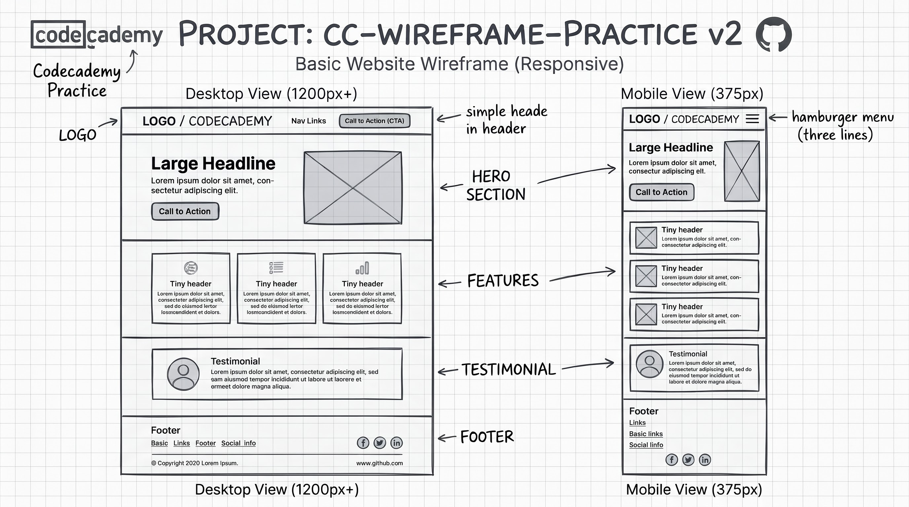

<div align="center">

<a href="https://www.codecademy.com" target="_blank" rel="noopener noreferrer">
  
</a>

# Responsive Wireframe Practice v2

A beginner-friendly responsive webpage project built as part of the **Codecademy Full-Stack Engineer** career path.

[](https://www.codecademy.com/journeys/full-stack-engineer/paths/fscj-22-web-development-foundations/tracks/fscj-22-improved-styling-with-css/modules/wdcp-22-build-a-website-design-system-2a08b912-678e-4186-ab57-86a0fb0ca601/projects/independent-project-web-design-system)
[](#)

</div>

---

## 📌 Project Overview

This project is part of my journey through the **Full-Stack / DevOps** learning path. The goal of this exercise is to translate a structured responsive wireframe into clean, semantic HTML and responsive CSS, ensuring seamless transitions across screen widths.

It serves as a practical implementation of the principles covered in the Codecademy project:
🔗 **[Build a Website Design System](https://www.codecademy.com/journeys/full-stack-engineer/paths/fscj-22-web-development-foundations/tracks/fscj-22-improved-styling-with-css/modules/wdcp-22-build-a-website-design-system-2a08b912-678e-4186-ab57-86a0fb0ca601/projects/independent-project-web-design-system)**

---

## 📐 Wireframe Reference

Below is the design target for both desktop and mobile viewports:

<div align="center">
  
</div>

- **Desktop View (`1200px+`)**: Horizontal navigation bar with logo and CTA, two-column hero section with headline and media placeholder, 3-card features row with "Tiny header" cards, a testimonial banner, and an expanded footer with social icons.
- **Mobile View (`375px`)**: Compact header featuring a 3-line hamburger menu toggle, single-column hero unit, vertically stacked feature cards, single-column testimonial, and a stacked footer.

---

## 🎯 Learning Objectives

- [ ] Practice semantic HTML5 elements (`<header>`, `<nav>`, `<main>`, `<section>`, `<footer>`).
- [ ] Implement responsive styling using **CSS Flexbox** and/or **CSS Grid**.
- [ ] Create adaptive layouts with CSS Media Queries (`min-width` / `max-width`).
- [ ] Establish design tokens (colors, font families, modular spacing) using CSS custom properties (`var(--...)`).
- [ ] Practice disciplined Git hygiene (atomic commits, clear commit messages, push to GitHub).

---

## 📁 Suggested Directory Structure

```text
cc-wireframe-practice-v2/
│
├── index.html          # Main HTML markup
├── styles/
│   ├── reset.css       # Standard CSS reset / box-sizing rules
│   └── style.css       # Main styles & media queries
├── assets/
│   ├── images/
│   │   └── wireframe.png   # Wireframe reference image
│   └── fonts/              # Custom typography (if needed)
└── README.md           # Project documentation
```

---

## 🚀 Getting Started

1. **Clone the repository:**
   ```bash
   git clone https://github.com/AstroboyMonsterHigh/cc-wireframe-practice-v2.git
   cd cc-wireframe-practice-v2
   ```

2. **Save the wireframe image:**
   - Save your wireframe image as `wireframe.png` inside the `assets/images/` directory so it renders automatically on GitHub.

3. **Open the project:**
   - Open `index.html` directly in your browser, or:
   - Run a lightweight live server from Termux / VS Code to inspect breakpoints and resize behavior in real time.

---

## 📚 Curriculum Reference

- **Track:** *Web Development Foundations — Improved Styling with CSS*
- **Module:** *Build a Website Design System*
- **Platform:** [Codecademy](https://www.codecademy.com/)